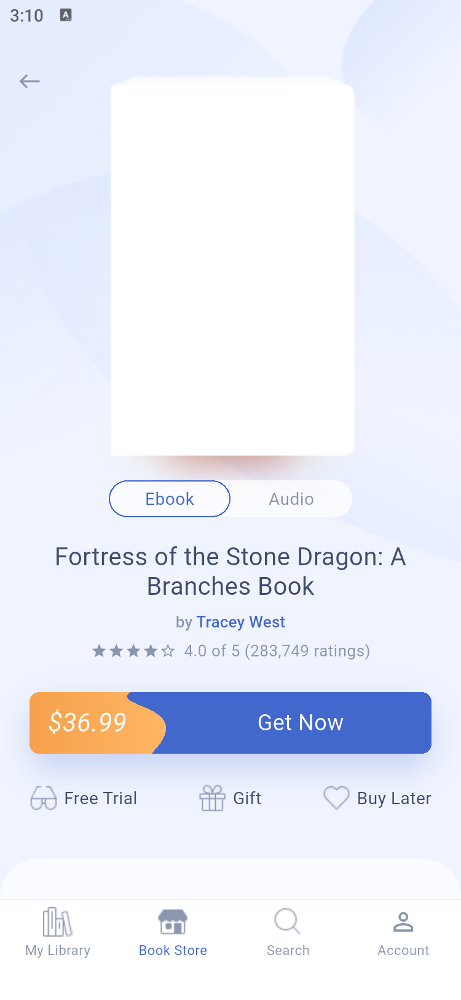
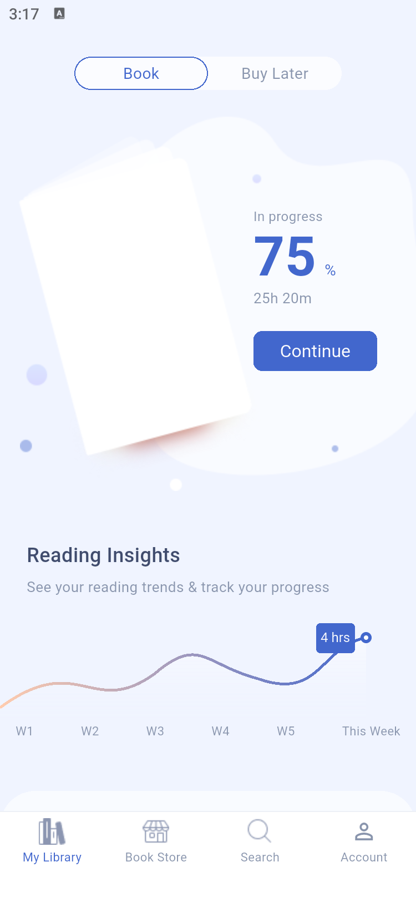
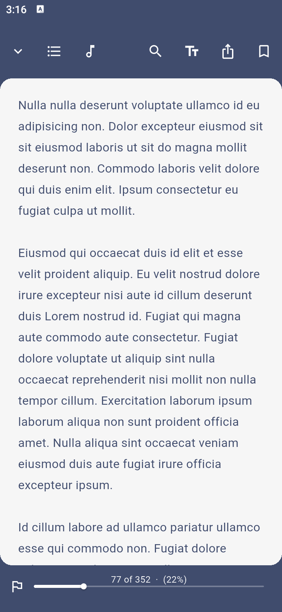
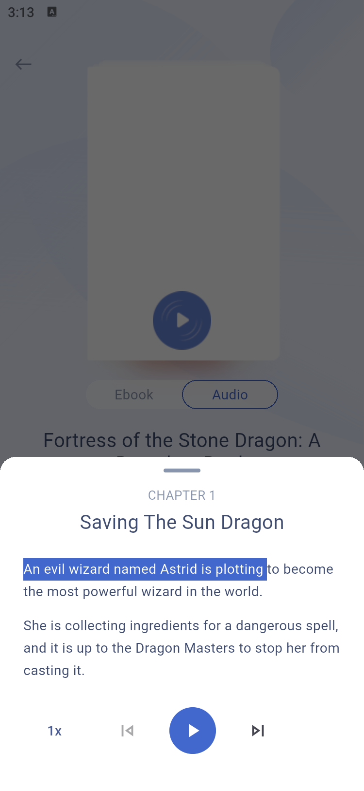

# BUUK Store Flutter 项目

BUUK Store 是一个电子书和有声书商店原型。可以从书店推荐、分类或搜索打开书籍详情，收藏书籍、试读电子书、试听有声书，并通过演示结算把书加入书库。界面保留了 Pixso 原稿的英文文案风格。

## 运行

项目通过 `.fvmrc` 固定 Flutter 3.41.6。使用已运行的 Android 模拟器时，可以先查设备 ID，再运行应用。

```sh
fvm flutter pub get
fvm flutter devices
fvm flutter run -d emulator-5554
```

已将 Flutter 3.41.6 加入 PATH 的环境可直接执行 `flutter`。本次在 Android 11 模拟器验证。项目保留 iOS 工程，iOS 构建与运行需在 macOS 和 Xcode 环境验证。

`flutter analyze` 已通过。模拟器验证了排序与筛选、评论提交、作者关注、离线试听、阅读设置与恢复、演示结算入库和按作者搜索。

## 主要界面

<p>
  
  
  
</p>
<p>
  
  
</p>

## 项目结构

```text
lib/
├── main.dart              MaterialApp、主题、全局状态入口
└── src/
    ├── store_state.dart   书目样例和会话状态
    ├── catalog.dart       登录、底部导航入口、书库、书店、分类、搜索和账户
    ├── book.dart          电子书与有声书详情、作者、评论、演示结算
    ├── reader.dart        阅读器、阅读偏好、试听面板及音频通道
    └── ui.dart            页面框架、底部导航、书卡、分段控件和通用弹层
assets/
├── pixso/                 MCP 导出的标志、插画、书封、背景和图标
└── audio/                 两段本地试听录音
android/                   Android 宿主与 MediaPlayer 播放通道
ios/                       iOS 宿主与 AVAudioPlayer 播放通道
docs/screenshots/          Android 模拟器运行截图
```

四个底部页签共用 `IndexedStack`，在页签切换时保留搜索输入和滚动位置。详情、作者和阅读器通过 Flutter `Navigator` 跳转。排序、分类、阅读设置、试听和结算共用底部弹层。

`StoreState` 通过 `ChangeNotifier` 通知界面更新，`StoreScope` 向各页提供书库、收藏、阅读进度、评论、作者关注和最近搜索。图书、账户和阅读趋势图使用本地样例，状态在本次应用会话内生效。社交登录按钮进入同一演示会话，结算按钮模拟确认并更新书库。音频由 Flutter 通过 `MethodChannel` 调用宿主播放器，可离线播放。Flutter 运行时仅依赖 Flutter SDK。

## Pixso 画板与截图

来源为 Pixso 的《BUUK STORE file for editing》。通过 MCP 读取 `design` 页的 18 张画板和 `symbol` 页的 67 个组件，并复用所需素材。主书封等留白来自原稿。截图由应用在 Android 模拟器中运行时采集。

| Pixso 画板 | Flutter 界面 | 截图 |
| --- | --- | --- |
| 01 login | 登录 | [PNG](docs/screenshots/01-login.png) |
| 02 library empty | 空书库 | [PNG](docs/screenshots/02-library-empty.png) |
| 03 library | 阅读进度与书库 | [PNG](docs/screenshots/03-library.png) |
| 04 book store | 书店 | [PNG](docs/screenshots/04-book-store.png) |
| 05 category detail | 分类书目 | [PNG](docs/screenshots/05-category-detail.png) |
| 06 category detail view sort | 排序弹层 | [PNG](docs/screenshots/06-category-sort.png) |
| 07 category detail select category | 分类筛选弹层 | [PNG](docs/screenshots/07-category-select.png) |
| 08 book details ebook | 电子书详情 | [PNG](docs/screenshots/08-ebook-detail.png) |
| 09 book details audio | 有声书详情 | [PNG](docs/screenshots/09-audiobook-detail.png) |
| 10 free trial audio book | 有声书试听 | [PNG](docs/screenshots/10-audio-preview.png) |
| 11 book reading | 阅读器 | [PNG](docs/screenshots/11-reader.png) |
| 12 config reading mode | 阅读设置 | [PNG](docs/screenshots/12-reading-settings.png) |
| 13 minimal current reading book | 收起阅读器后的详情 | [PNG](docs/screenshots/13-minimized-reader.png) |
| 14 review | 评分与评论 | [PNG](docs/screenshots/14-review.png) |
| 15 author details | 作者主页 | [PNG](docs/screenshots/15-author.png) |
| 16 get book | 演示结算 | [PNG](docs/screenshots/16-checkout.png) |
| 17 search | 搜索 | [PNG](docs/screenshots/17-search.png) |
| 18 account | 账户 | [PNG](docs/screenshots/18-account.png) |
